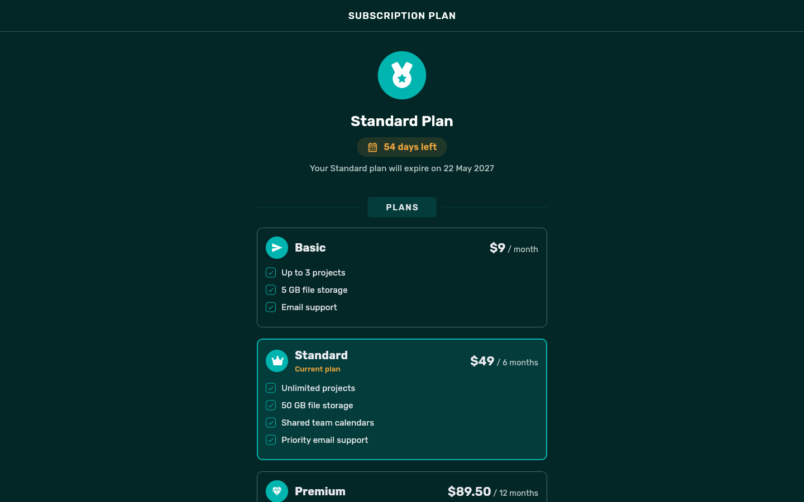
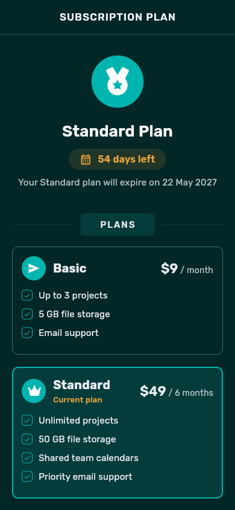
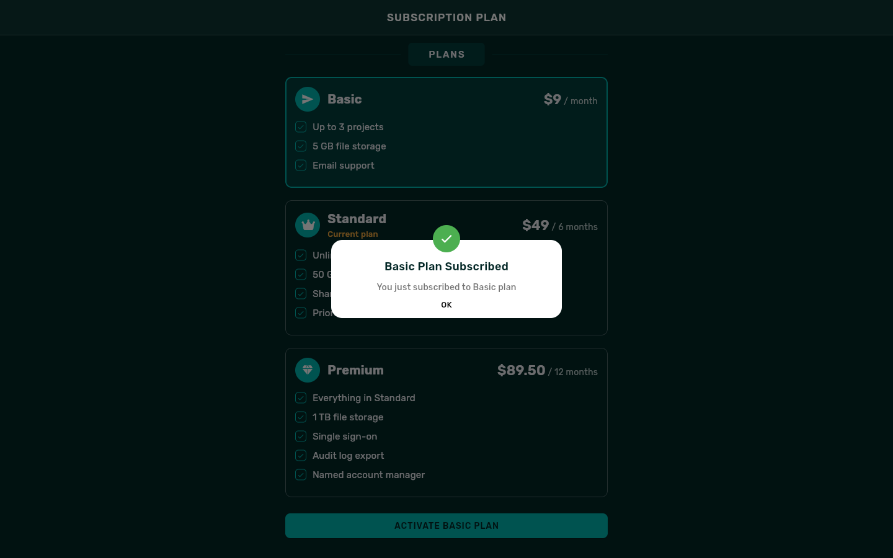
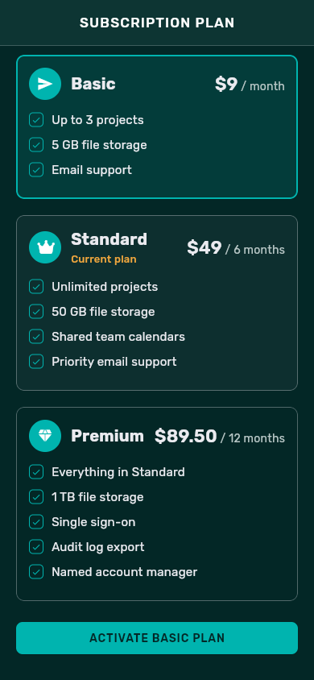
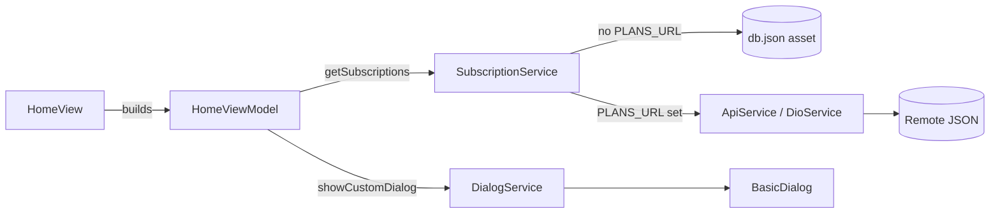

# Subscription Plan

A single-screen Flutter app for managing a subscription. It shows the plan
the user is on and how many days it has left. Below that, it lists every plan
on offer with its price, billing period and features. Users can select
another tier and confirm the switch in a dialog. The app uses the
[Stacked](https://pub.dev/packages/stacked) MVVM architecture. The web build
is the one built and tested here. The standard Flutter runners for mobile and
desktop are also included.

This project is based on [Subscription-Plan](https://github.com/usmanasif/Subscription-Plan)
by usmanasif. The original README linked a demo video from that repository.
The screen design, the Stacked structure and the custom dialog all come from
that project. This copy updates the toolchain, fixes bugs, adds an offline
data source, error and empty states, responsive layout and tests.

| Desktop | Mobile |
| --- | --- |
|  |  |
|  |  |

The screenshots come from the web build using the bundled demo data in
`db.json`. The plans and their features are made up.

## What it does

- Shows the current plan, the days left and the expiry date.
- Lists every plan with its price per billing period ("$49 / 6 months") and
  its features. The current plan is labelled and preselected.
- Lets the user tap or keyboard-focus a plan to select it. The button below
  the list then reads "ACTIVATE BASIC PLAN" and so on. It is disabled while
  the current plan is selected.
- Confirms the switch in a custom success dialog. **No change is sent
  anywhere:** there is no backend, so activation only shows the confirmation.
- Pull to refresh reloads the plans. If loading fails, the screen shows the
  reason and a "Try again" button. An empty catalogue gets its own message.

## Running it

### With Docker (no Flutter install needed)

```bash
docker build -t subscription-plan .
docker run --rm -p 8080:80 subscription-plan
```

Then open <http://localhost:8080>. The build stage uses the pinned
`ghcr.io/cirruslabs/flutter:3.44.0` image. Before building the web release,
it runs `flutter analyze` and the test suite. nginx serves the result.

### With a local Flutter SDK

You need Flutter 3.44 (Dart 3.12). `.fvmrc` pins that version for
[FVM](https://fvm.app) users.

```bash
flutter pub get
flutter run -d chrome        # or an emulator / connected device
```

### Using your own plan data

By default the app reads `db.json` from its asset bundle, so it works
offline. To load plans from a server instead, pass a URL at build time. The
URL must return JSON in the same shape:

```bash
flutter run -d chrome --dart-define=PLANS_URL=https://example.com/plans.json
```

The `db.json` shape is:

```json
{
  "plan": "Standard",
  "date": "22 May 2027",
  "daysLeft": 54,
  "subscriptions": [
    {
      "id": 2,
      "name": "Standard",
      "price": 49,
      "currency": "$",
      "features": ["Unlimited projects", "50 GB file storage"],
      "duration": 6
    }
  ]
}
```

`duration` is the billing period in months. `price` may be fractional. The
`plan` field must match one plan's `name`. If a field is missing or has the
wrong type, the app shows the error state instead of crashing.

## Checks

```bash
flutter analyze
flutter test        # 17 tests: models, data sources, view model, widgets
```

`lib/app/app.locator.dart` and `app.router.dart` are generated by
`stacked_generator` from `lib/app/app.dart`. Regenerate them after you change
routes or services:

```bash
dart run build_runner build
```

## How it fits together



- **View**: `lib/ui/home/` holds the screen and its widgets: the current-plan
  summary, the plan tiles, the action button and the status message used for
  the error and empty states.
- **ViewModel**: `HomeViewModel` loads the catalogue and tracks the selected
  plan. It turns Dio and parsing failures into a readable `loadError`. Its
  services come in through the constructor, so the tests pass in stubs.
- **Services**: `SubscriptionService` chooses the data source.
  `DioService` implements the `ApiService` interface on top of Dio, with
  15-second connect and receive timeouts.
- **Models**: `Subscriptions` and `Subscription` in
  `lib/models/application_models.dart` validate JSON with Dart 3 patterns.

## Design notes

- **Bundled data by default.** The original fetched from a mocki.io mock
  that now returns 404. With the data as an asset, the app, the tests and
  the screenshots no longer depend on a third-party endpoint.
  `--dart-define=PLANS_URL` keeps the network path available.
- **Plain logical pixels.** The original scaled every size with
  `flutter_screenutil`, which made a desktop browser render huge widgets.
  The content column now stops at 560px and the layout uses standard
  Flutter sizing.
- **Accessibility.** Plan tiles are real buttons with focus and hover
  feedback and selected semantics. The action button uses dark text on teal
  (about 7:1 contrast), and dialog buttons have 44px touch targets.
- **Typeface.** The styles always asked for Rubik. It is now bundled
  (`assets/fonts/`, SIL Open Font License) instead of silently falling back.
- The package is still named `flutter_stacked_starter`, after the starter
  template the original was built from. Renaming it would touch every import
  for no functional gain.

## Project layout

```
lib/
  app/           Stacked setup (app.dart) and generated locator, router, logger
  constants/     colours, timeouts, data-source settings
  enums/         dialog type and status
  exceptions/    Dio error to message mapping
  models/        plan catalogue models
  services/      ApiService, DioService, SubscriptionService
  ui/home/       the plan screen, its view model and widgets
  utils/         spacing, text constants, Dio client, custom dialog
test/            unit and widget tests
db.json          demo plan catalogue (bundled as an asset)
```

The `android/`, `ios/`, `linux/`, `macos/` and `windows/` folders are the
standard `flutter create` runners. Only the web build is built and checked
here. The native targets have not been built since the toolchain upgrade.
